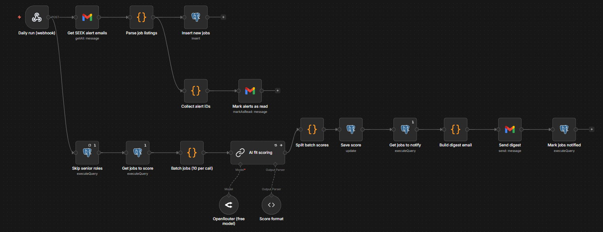
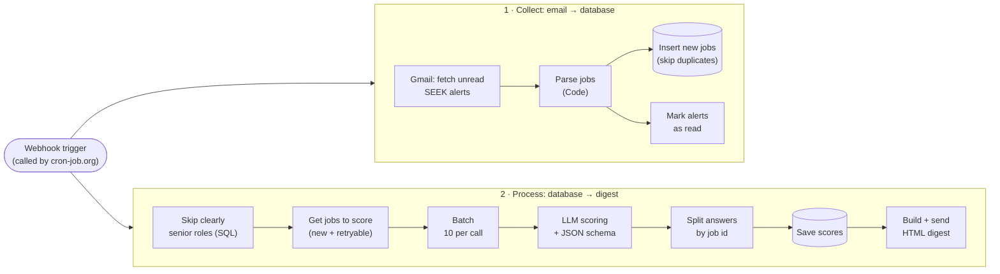

# SEEK Job Alert Pipeline (n8n + AI)

An automated pipeline that turns SEEK job alert emails into a **ranked daily digest**. It parses each alert, stores the postings in PostgreSQL, scores every role against a candidate profile with a free LLM, and emails only the roles worth applying for, each with a fit score, a one-line reason, and red flags to check.

Built with **n8n**, **Supabase (PostgreSQL)**, **OpenRouter**, the **Gmail API** and **JavaScript**, and deployed on **Render** at zero running cost.



## The problem

SEEK sends a recommendation email every day with a dozen roles, and many of them are senior positions, non-technical roles, or repeats from earlier days. Reading each ad to find the few genuine matches takes time. This pipeline does that first pass automatically.

## How it works



1. **Collect.** The Gmail node fetches unread SEEK recommendation emails. A Code node parses each email's plain-text body into structured jobs (title, company, location, salary, highlights), and they are inserted into Postgres, skipping duplicates.
2. **Process.** A SQL filter drops clearly senior roles before any AI call. Remaining jobs are sent to an LLM **10 at a time**, and the reply must match a JSON schema (`fit_score`, `fit_reason`, `red_flags`). Scores are saved, and every job scoring **60+** goes into one HTML digest email, sorted by score.

Each job moves through a `status` column: `new` → `filtered_out` / `scored` / `error` → `notified`, so every job is scored once and emailed once.

## Design decisions

| Decision | Why |
|---|---|
| **Use SEEK's own alert emails** as the data source | SEEK's API does not offer job search, and scraping the site is against its terms. The alert emails are data SEEK already sends to the user. |
| **Parse the plain-text email body**, not the HTML | The text layout is stable. Tested against 281 real alert emails, it extracted all 12 jobs from every one. |
| **De-duplicate on title + company + location** | Every SEEK link is a tracking redirect with no job ID, so the job's identity is built from its content. |
| **Separate "collect" and "process" branches** with the database in between | Scoring runs even on days with no new email, so failed jobs are retried without waiting for the next alert. |
| **Batch 10 jobs per LLM call** | Keeps a typical day to 1–3 requests, well within free-tier limits. |
| **Structured output** validated against a JSON schema | Invalid replies are caught instead of being written to the database. |
| **Match AI answers to jobs by id**, not by n8n item linking | n8n's LLM chain node doesn't preserve item links, so answers are matched by the job id included in each batch. |
| **Retries with a cap** (`retry_count < 3`) | Temporary provider errors (rate limits, 502s) are retried on later runs; a job that keeps failing stops using quota after 3 attempts. |
| **Cheap filter before the LLM** | A regex in SQL removes obviously senior roles at no API cost. |
| **Row Level Security** on the Supabase tables | Supabase exposes `public` tables through its API; RLS with no policies blocks that, while n8n connects as the database owner. |

## Tech stack

| Area | Tools |
|---|---|
| Orchestration | n8n 2.x (self-hosted, Docker) |
| Database | PostgreSQL on Supabase |
| AI | OpenRouter free models via n8n's Basic LLM Chain + Structured Output Parser |
| Email | Gmail API (OAuth 2.0) |
| Code | JavaScript (n8n Code nodes), SQL |
| Hosting | Render (free web service), custom domain via Cloudflare DNS |
| Scheduling | cron-job.org calling a header-authenticated webhook |
| Testing | Node.js built-in test runner |

## Repository layout

```
├── workflow/seek-job-alert-pipeline.json   # n8n export (credentials removed): the source of truth
├── code/                                   # generated from the workflow for easy reading
│   ├── nodes/       # JavaScript from each Code node
│   ├── sql/         # queries from each Postgres node
│   └── ai/          # LLM prompt and output JSON schema
├── database/
│   ├── schema.sql          # tables, indexes, RLS
│   └── seed-test-jobs.sql  # sample jobs for testing the scoring step
├── tests/                  # unit tests for the Code nodes, with synthetic sample emails
├── scripts/extract-node-code.js
├── deploy/                 # environment variable templates (no secrets)
└── docs/deployment.md      # full deployment guide
```

The files in `code/` are generated: `npm run extract` reads the workflow export and rewrites them, so they always match what n8n runs.

## Running it yourself

1. **Database:** run `database/schema.sql` in a Supabase (or any PostgreSQL) database.
2. **n8n:** import `workflow/seek-job-alert-pipeline.json` and create four credentials: Postgres, Gmail OAuth2, OpenRouter, and Header Auth for the webhook.
3. **Personalise:** set your email in **Send digest**, your Gmail label in **Get SEEK alert emails**, and your own profile in the **AI fit scoring** prompt.
4. **Test:** run `database/seed-test-jobs.sql`, then execute the workflow and check the `jobs` table.
5. **Deploy and schedule:** see [docs/deployment.md](docs/deployment.md).

## Tests

```bash
npm test
```

The tests run the Code nodes' JavaScript outside n8n against synthetic SEEK-style emails. They cover parsing edge cases (wrapped lines, labels such as "Featured" and "Immediate start", two-line company names), de-duplication, batching, and how AI answers are reconciled (missing answers, failed calls, out-of-range scores).

## Limitations

- **Depends on SEEK's email format.** If SEEK changes its layout, the parser needs updating; the tests make that quick to check.
- **Alerts contain a short summary, not the full job ad**, so scores are based on the title, company, location, salary and highlights.
- **Free-tier trade-offs:** Render cold starts take about a minute, free LLMs can be rate-limited (handled by retries), and the Gmail OAuth app in Testing mode needs re-authorising weekly.
- **Scores are AI-generated** and only a first filter. Every ad still needs a human read.

## Possible extensions

- More sources (for example the Adzuna API or company careers pages) feeding the same `jobs` table
- A small dashboard of scored jobs and application status
- Application tracking: marking jobs as applied, interviewing, or rejected

---

Built by Brandon · [GitHub](https://github.com/bilitixi) · [LinkedIn](https://linkedin.com/in/le-nam-anh-nguyen-0692612b2)
