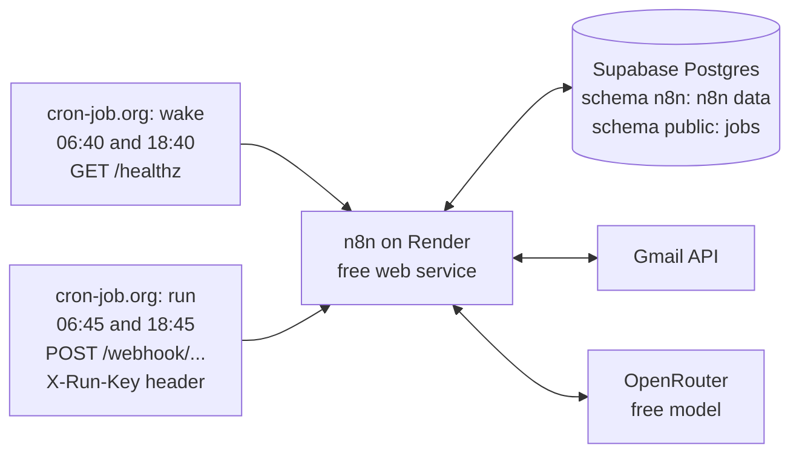

# Deployment

The pipeline runs on n8n hosted on **Render's free tier**, with **Supabase** (PostgreSQL) holding both the job data and n8n's own data. Because free Render services sleep after 15 minutes without traffic, the workflow is started by an external scheduler instead of n8n's internal Schedule Trigger.



## 1. Database (Supabase)

1. Create a Supabase project.
2. Run [`database/schema.sql`](../database/schema.sql) in the SQL Editor. It creates the `jobs` and `workflow_runs` tables (with Row Level Security enabled) and an empty `n8n` schema for n8n's own tables.
3. Note the **Session pooler** connection details (Connect → Session pooler). The direct connection is IPv6-only on the free plan, which Render and most Docker setups can't reach.

## 2. n8n on Render

1. Render → **New → Web Service → Existing Image** → `docker.io/n8nio/n8n:<version>`. Pin a version rather than `latest`.
2. Instance type **Free**; region close to your Supabase project.
3. Environment: paste [`deploy/render.env.example`](../deploy/render.env.example) and fill in the values.
4. Advanced → Health Check Path: `/healthz`.
5. Optional: add a custom domain (Render → Settings → Custom Domains). With Cloudflare DNS, set the record to **DNS only**, so Render can issue and renew the certificate. Then set `N8N_HOST` and `WEBHOOK_URL` to the custom domain.

### Create the owner account before the site is public

A fresh n8n instance shows "Set up owner account" to whoever opens it first. To avoid that window, set everything up from your own machine against the same database **before** starting the Render service:

1. Copy [`deploy/local.env.example`](../deploy/local.env.example) to `deploy/local.env` and fill it in. Use **the same `N8N_ENCRYPTION_KEY` as Render**.
2. `docker run --rm -it -p 5678:5678 --env-file deploy/local.env n8nio/n8n:<version>`
3. At `http://localhost:5678`: create the owner, import [`workflow/seek-job-alert-pipeline.json`](../workflow/seek-job-alert-pipeline.json), and create the credentials (below).
4. Stop the local container, then start the Render service. It loads everything from Supabase and shows a login page.

## 3. Credentials (created in n8n, never committed)

The workflow needs four credentials: Postgres (Supabase), Gmail OAuth2, OpenRouter, and Header Auth for the webhook. **[credentials.md](credentials.md) covers each one step by step**, including the Google Cloud setup and troubleshooting.

When n8n runs on a server, add its callback to the Google OAuth client's redirect URIs as well as the local one: `https://<your-domain>/rest/oauth2-credential/callback`.

After importing, also set:
- **Send digest → To**: your email address.
- **Get SEEK alert emails → Search**: your Gmail label, e.g. `label:Seek is:unread subject:"new jobs" newer_than:7d`.
- **Daily run (webhook) → Path**: a hard-to-guess path.

Then **Publish** the workflow.

## 4. Scheduler (cron-job.org)

Account time zone: `Pacific/Auckland`.

| Job | Schedule (crontab) | Request |
|---|---|---|
| Wake | `40 6,18 * * *` | `GET https://<your-domain>/healthz`. Failure notifications off: it may time out while Render wakes |
| Run | `45 6,18 * * *` | `POST https://<your-domain>/webhook/<path>`, headers `X-Run-Key: <secret>` and `Content-Type: application/json`, body `{}` |

SEEK recommendation emails arrive around 6pm NZ time, so the evening run gives same-day results and the morning run retries anything that failed.

## 5. Updating the workflow

1. Edit in the n8n editor, then **Publish** (saved changes only go live once published).
2. Export it (**⋯ → Download**), remove personal values (your email address, webhook path), and replace `workflow/seek-job-alert-pipeline.json`.
3. Regenerate the readable code and run the tests:
   ```bash
   npm run extract
   npm test
   ```
